# SUDHARSHAN AI (Alpha v0.9) — SYSTEM ARCHITECTURE SPECIFICATION

**Project**: Sudharshan AI (Alpha v0.9 • Sudharshan Core v0.9-alpha)  
**Lead Engineer**: Kaushik Ram Ravuru (B.E. IT, Section IT-1, CBIT Hyderabad)  
**Contact**: kaushikramravuru@gmail.com  
**Remote**: `https://github.com/rkrworks/Sudharshan-AI.git`  
**Web Portals**: `https://sudharshan-ai.vercel.app` & `https://rkrworks.github.io/Sudharshan-AI/`  

---

## 1. High-Level System Architecture

Sudharshan AI is a high-performance, security-hardened, cross-platform AI assistant designed for **Windows 11** and **Fedora Linux (GNOME/Wayland)**. It operates on a unified core engine (`bajrang_core.py`) with OS-specific presentation layers (`windows.py` and `fedora.py`) and a cryptographically verified server backend (`razorpay_server.py`).

```mermaid
flowchart TD
    subgraph UI_Layer["User Interaction Layer"]
        WinHUD["Windows 11 Desktop HUD (Tkinter/Win32)"]
        FedHUD["Fedora GNOME HUD (GTK4/Libadwaita)"]
        WebPortal["Static Web Portal (web/index.html)"]
    end

    subgraph Core_Engine["Sudharshan Core Engine (bajrang_core.py)"]
        Engine["BajrangEngine (Coordinator)"]
        Safety["SafetyGuard (Zero-Arg Trampoline Guard)"]
        Vault["SecurityVault (OS Keyring / DPAPI / Secret-Tool)"]
        Storage["LocalChatStorage (SQLite WAL & Auto-Migrations)"]
        Voice["SpectralVoiceSpotter (8-Band Goertzel DTW DSP)"]
        TaskPlan["AutonomousTaskPlanner (.bajrang_trash Staging)"]
        AutoBuild["AutomationBuilder (Visual Workflow Engine)"]
        ModelMgr["LocalAIModelManager (Ollama Daemon & Catalog)"]
        SysIntel["SystemIntelligenceDashboard (Hardware Telemetry)"]
        ProvDash["IntelligentProviderDashboard (Latency Probes)"]
        DevCo["DeveloperCopilot (Diffs, AST & Code Inspector)"]
        DiagCentre["DiagnosticsRecoveryCentre (PRAGMA Health Checks)"]
    end

    subgraph Backend_Layer["Server & Cloud Integration"]
        RazorServer["razorpay_server.py (2048-Bit RSA Key Signer)"]
        OllamaLocal["Local Ollama Daemon (Llama 3.2 3B / Mistral 7B)"]
        CloudProviders["Cloud BYO Providers (Gemini / Groq / OpenAI)"]
    end

    WinHUD --> Engine
    FedHUD --> Engine
    Engine --> Safety
    Engine --> Storage
    Engine --> Vault
    Engine --> Voice
    Engine --> TaskPlan
    Engine --> AutoBuild
    Engine --> ModelMgr
    Engine --> SysIntel
    Engine --> ProvDash
    Engine --> DevCo
    Engine --> DiagCentre

    Engine --> OllamaLocal
    Engine --> CloudProviders
    WebPortal -.->|Order APIs| RazorServer
```

---

## 2. The 10 Core Architectural Features

### Feature 1: Intelligent Conversation Manager
- **Storage**: SQLite3 database in Write-Ahead Logging (`PRAGMA journal_mode=WAL`) mode with synchronized migrations (`DatabaseMigrationManager`).
- **Data Model**: `sessions` table tracks `session_id`, `title`, `category`, `is_pinned`, `created_at`, `updated_at`.
- **Operations**:
  - `search_conversations(query)`: Full-text case-insensitive keyword search over session messages.
  - `pin_session(sid, pinned)`: Keeps mission-critical contexts pinned to the top of the session list.
  - `rename_session(sid, new_title)`: Updates session titles.
  - `export_session_markdown(sid)` & `export_session_json(sid)`: Structured file export with role metadata and execution trace.
  - `import_session_json(json_text)`: Imports external session archives into local SQLite storage.

### Feature 2: Advanced Voice Studio
- **DSP Architecture**: Built-in 8-Band Goertzel Spectral-DTW (Dynamic Time Warping) filter bank operating at 16 kHz mono PCM. Zero mandatory cloud STT dependencies.
- **Spectral Noise Subtraction**: Real-time noise floor estimation using the initial 200 ms ambient silence frame.
- **Wake Word Recognition**: Configurable wake word (`"hey sudharshan"`, `"hey bajrang"`).
- **Speech Synthesis**: SAPI5 (Windows) and Speech-Dispatcher/espeak-ng (Fedora) with configurable speech rate and pitch.

### Feature 3: Visual Automation Builder
- **Workflow Pipeline**: `AutomationBuilder` manages discrete multi-step automation sequences (`WorkflowStep`, `Workflow`).
- **Safety Conditions**: Validates pre-conditions (e.g. `file_exists`, `platform_is`) before triggering actions.
- **Confirmation Gate**: High-risk steps are marked `requires_confirmation=True` and paused until approved via `confirm_pending_actions()`.
- **Audit Logging**: Each run records `workflow_id`, status, timestamp, and per-step execution logs in the `workflow_runs` table.

### Feature 4: Advanced Memory Management
- **Personalized Context**: `memories` table stores persistent user facts categorized by domain (`general`, `preferences`, `credentials`, `system`).
- **Importance Scoring**: Memories are rated from 1 to 5 to prioritize prompt injection context windows.
- **Deduplication Engine**: `find_duplicate_memories()` computes Jaccard word-overlap similarity to flag redundant entries.
- **Privacy Boundary**: Built-in PII redaction cleans sensitive credit card, Aadhaar, and password patterns before committing memories.

### Feature 5: Local AI Model Manager
- **Catalog Management**: Maintains curated metadata for 6 major open-weights models (Llama 3.2 3B, Llama 3.1 8B, Llama 2 7B, Mistral 7B, Gemma 2 2B, CodeLlama 7B).
- **Ollama Interop**: Probes `http://localhost:11434/api/tags` to discover running daemon versions and installed model weights.
- **Hardware Tier Compatibility**: Evaluates system RAM and VRAM to classify host into Workstation (16GB+), High (12GB+), Balanced (8GB+), or Eco (<8GB).

### Feature 6: System Intelligence Dashboard
- **Authentic Telemetry**: Queries OS-level `/proc`, `psutil`, `wmic`, and Win32 APIs for authentic hardware statistics. Never fabricates metrics.
- **Telemetry Points**: CPU utilization percentage, RAM usage (total, used, free), disk space, battery status, and network reachability.
- **History Buffer**: Retains a rolling 60-second time-series buffer for real-time sparkline visualization.
- **Resource Alerts**: Triggers warnings when CPU exceeds 90% or RAM exceeds 85%.

### Feature 7: Intelligent Provider Dashboard
- **Multi-Cloud Router**: Directs inference requests to Local Ollama, Google Gemini, Groq, or OpenAI.
- **Active Probing**: Measures live round-trip latency (`/v1/models` or ping endpoints) across registered providers.
- **Token Accounting**: Tracks cumulative token consumption and estimated INR expenditure.
- **Dynamic Fallback**: Automatically switches from slow or rate-limited endpoints to available alternatives.

### Feature 8: Universal Floating Assistant
- **Desktop HUD**: Low-latency native desktop interface with dark/light themes.
- **Always-on-Top Toggle**: Keeps the assistant HUD floating above all IDE and browser windows.
- **Compact View**: Switches to an ultra-compact micro-bar (480x140) for minimal desktop footprint.
- **Clipboard Assistant**: Directly inspects clipboard content to provide instant explanations, summaries, or code refactorings.

### Feature 9: Developer Copilot
- **Codebase Inspection**: Scans directory trees with strict path traversal guards to list structure and locate files.
- **Unified Diffing**: Generates standard unified diffs via Python's `difflib` for transparent code modifications.
- **Traceback Debugger**: Parses Python tracebacks to identify exact file paths, line numbers, and error root causes.
- **Safe Command Generator**: Proposes build and test commands strictly filtered through the allowlist launcher.

### Feature 10: Diagnostics & Recovery Centre
- **Health Verification**: Runs 6-point pre-flight checks (Database integrity, Vault access, Platform adapter, Memory, Voice engine, Network).
- **PRAGMA Integrity Check**: Executes `PRAGMA integrity_check` on the SQLite database to detect database corruption.
- **Safe Backup & Restore**: Creates timestamped SQLite database backups and provides atomic restore capability.
- **Report Generation**: Exports comprehensive markdown and JSON diagnostic reports for technical support.

---

## 3. Cryptographic & Security Model

| Invariant | Protection Mechanism | Verification Suite |
| :--- | :--- | :--- |
| **C1 / H5** | 2048-bit RSA asymmetric signature verification (`BAJRANG-V6-`). Symmetric `BAJRANG-PRO-*` tokens rejected. | `test_bajrang_suite.py` (Test 1) |
| **C2** | Zero client-side owner credentials or key minting logic in HTML or client JS. | Static regex audit & `razorpay_server.py --self-test` |
| **C3** | Zero-argument allowlist launcher (`len(tokens) > 1` blocked). Prevents shell injection. | `windows.py --self-test` (Test 1) |
| **C4** | `shell_exec` excluded from tool dispatch. Direct binary execution only. | `bajrang_core.py --self-test` (Test 2) |
| **C5** | Non-destructive file ops with `.bajrang_trash/` undo staging and size bucketing. | `test_bajrang_suite.py` (Test 3) |
| **C6** | `SecurityVault` isolates BYO API keys in OS hardware credential managers (DPAPI/Keyring). | `fedora.py --self-test` (Test 5) |
| **H1** | Modular project exporter copies both `fedora.py` and `bajrang_llama32.py`. | `fedora.py --self-test` (Test 6) |
| **H2** | Dual emergency kill-switch (`Ctrl+Shift+K` on Win32, UNIX socket on Fedora). | `fedora.py --self-test` (Test 7) |
| **H7** | Deployment boundary: static portal served strictly from `web/` directory. | `vercel.json` & `.github/workflows/deploy.yml` |
| **H8** | Thread-safe UI marshaling via `queue.Queue` and session-pinned prompt execution. | `windows.py --self-test` (Test 3) |

---

## 4. Hardware Sizing & Recommended Models

| Tier | Minimum RAM | Recommended GPU | Local Model | Quantization | Context Window |
| :--- | :--- | :--- | :--- | :--- | :--- |
| **Eco** | 8 GB | Integrated (Intel/AMD) | Llama 3.2 (3B) | Q4_K_M | 8k tokens |
| **Balanced** | 16 GB | RTX 3050 / RX 6600 (4-6GB) | Mistral (7B) | Q4_K_M | 16k tokens |
| **High** | 32 GB | RTX 3060 / 4060 (8-12GB) | Llama 3.1 (8B) | Q5_K_M | 32k tokens |
| **Workstation** | 64 GB+ | RTX 3090 / 4090 (16-24GB) | CodeLlama (70B) / Qwen 2.5 | Q4_K_M | 64k tokens |
