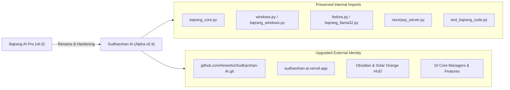

# SUDHARSHAN AI — MIGRATION GUIDE (Bajrang AI Pro → Sudharshan AI Alpha v0.9)

**Author**: Kaushik Ram Ravuru (B.E. IT, Section IT-1, CBIT Hyderabad)  
**Project**: Sudharshan AI (Alpha v0.9)  

---

## 1. Overview of Changes

Following the evolution of the project from **Bajrang AI Pro** to **Sudharshan AI (Alpha v0.9)**, several breaking repository-level and cosmetic branding changes occurred while internal module interfaces were preserved to maintain 100% backward compatibility.



---

## 2. Git Remote & Repository Synchronization

If your local clone still points to the old repository name, update your remote URL:

```bash
# Check current remote
git remote -v

# Update remote origin to the new canonical repository
git remote set-url origin https://github.com/rkrworks/Sudharshan-AI.git

# Verify remote configuration
git remote -v
# Output should show:
# origin  https://github.com/rkrworks/Sudharshan-AI.git (fetch)
# origin  https://github.com/rkrworks/Sudharshan-AI.git (push)
```

---

## 3. SQLite Database Schema Migration (v1 → v4)

Sudharshan AI maintains automatic forward migrations without requiring manual SQL commands.

| Migration Version | Description | Schema Changes |
| :--- | :--- | :--- |
| **v1** | Initial session and message tracking | `sessions`, `messages` |
| **v2** | Long-term memory store | Added `memories` table with category indexing |
| **v3** | Autonomous task runs & audit | Added `task_runs` and `security_audit_log` |
| **v4 (Alpha v0.9)** | Advanced conversation management | Added `category` and `is_pinned` columns to `sessions`; added `workflow_runs` table |

When you launch Sudharshan AI for the first time, `DatabaseMigrationManager` detects the existing database at `%LOCALAPPDATA%\SudharshanAI\history.db` (or `~/.local/share/bajrang/history.db`) and executes non-destructive `ALTER TABLE` statements inside an atomic transaction.

---

## 4. Desktop Client File Aliases & Entry Points

To avoid breaking legacy scripts and shortcuts, the following file aliases are actively maintained:

| Canonical Implementation | Legacy Alias | Compatibility Role |
| :--- | :--- | :--- |
| `windows.py` | `bajrang_windows.py` | Windows 11 Tkinter HUD & Win32 adapter |
| `fedora.py` | `bajrang_llama32.py` | Fedora Workstation GTK4 HUD & Wayland adapter |
| `setup_fedora.sh` | `setup_fedora.bash` | Linux environment setup & GNOME extension installer |

---

## 5. Security Vault & Credential Migration

If you previously configured API keys in the legacy system:
- `SecurityVault` continues to read and write to the same OS-level credential vault service names (`bajrang_ai_vault` / `sudharshan_ai_vault`).
- API keys stored in Windows Credential Manager or GNOME Keyring remain immediately accessible.
- Any API keys mistakenly stored in `settings.json` are automatically migrated to the hardware vault and stripped from disk.
